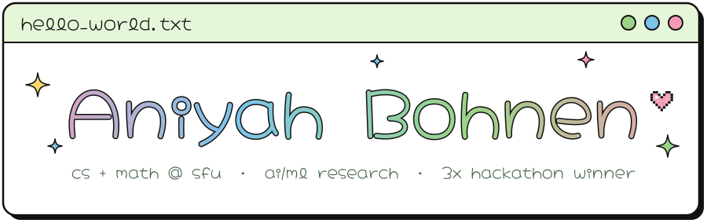
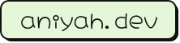
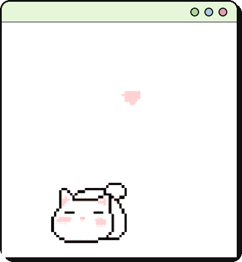

<p align="center">
  
</p>

<p align="center">
  <a href="https://aniyah.dev"></a>&nbsp;
  <a href="https://www.linkedin.com/in/aniyah-bohnen/"></a>&nbsp;
  <a href="https://devpost.com/keklulubb"></a>&nbsp;
  <a href="mailto:aba296@sfu.ca"></a>
</p>

<h2>hi there, i'm aniyah </h2>

<p><em>
  AI/ML data researcher at MANTA Lab
  
  <br>
  Software developer at <a href="https://sfusurge.com">SFU Surge</a>
  
  <br>
  Computer Science + Mathematics at <a href="https://www.sfu.ca">Simon Fraser University</a>
  
  <br>
  3x hackathon winner on <a href="https://devpost.com/keklulubb">Devpost</a>
  
</em></p>



### a little more about me... 

```python
aniyah = {
    "based_in": "Vancouver, BC",
    "studying": "CS + Math @ Simon Fraser University",
    "doing_now": ["AI/ML research @ MANTA Lab",
                  "software dev @ SFU Surge"],
    "code": ["Python", "TypeScript", "SQL",
             "C++", "R", "MATLAB"],
    "tools": ["PyTorch", "Pandas", "scikit-learn",
              "React", "Docker", "Slurm", "AWS"],
    "wins": {
        "ShopGuard": "2nd place @ AI Champion Ship",
        "CosmoCare": "Best Gemini @ Hack the Galaxy",
        "EcoGPT":    "Impact Challenge @ cmd-f 2025",
    },
    "community": ["SFU WiCS", "SFU Surge"],
    "speaks": ["English", "Dutch",
               "Russian", "Mandarin"],  # last two: learning!
}
```

 <em><b>i love meeting new people,</b> so if you want to talk AI, data or hackathons, say <b>hi</b>!</em>

<br clear="right">

### my github activity 

<p align="center">
  
  
</p>

<p align="center">
  
</p>

<p align="center">
  
  <em>thanks for stopping by!</em>
  
</p>
